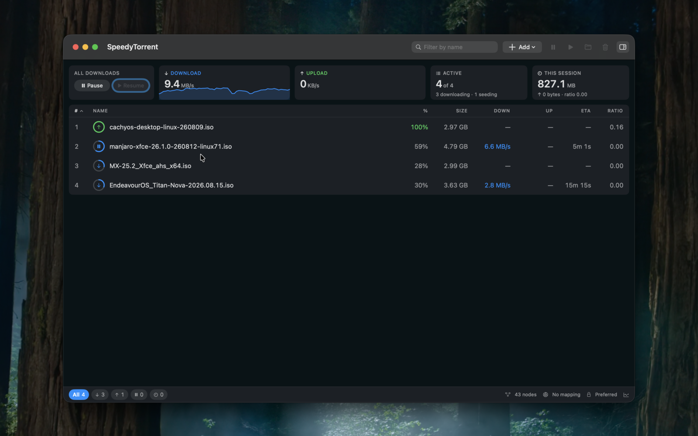
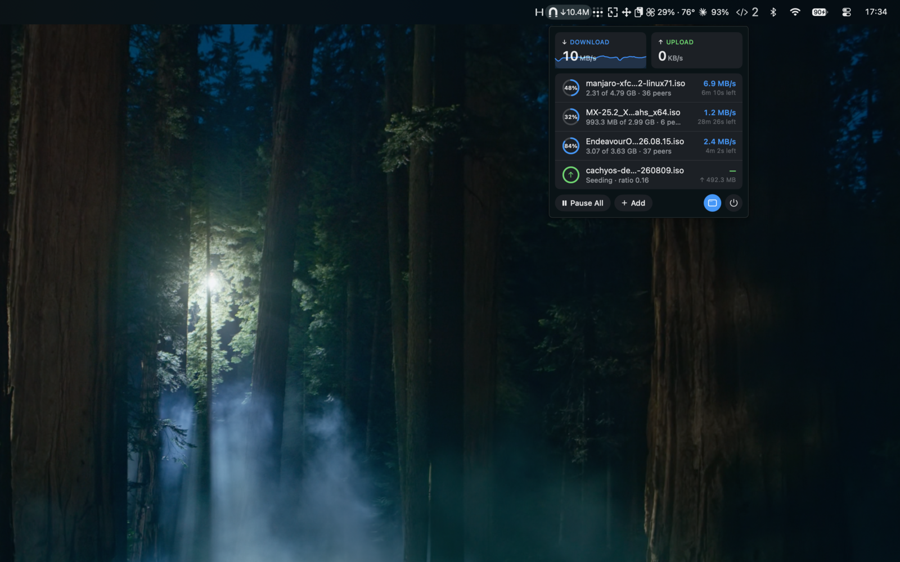
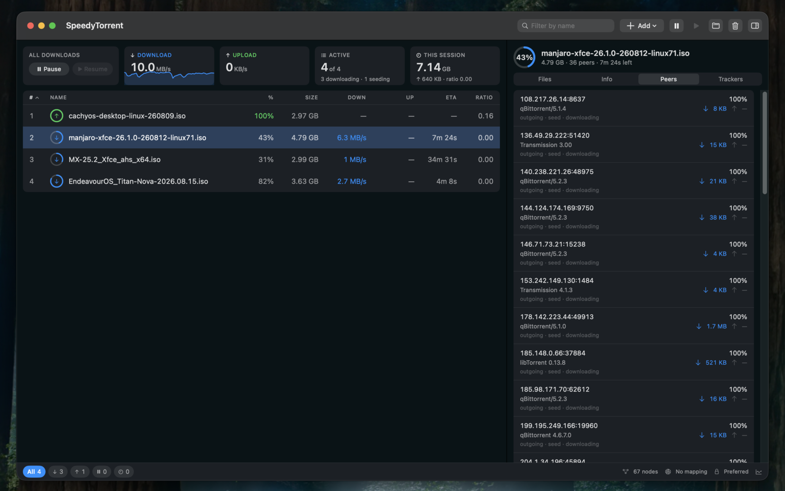

# SpeedyTorrent

A native BitTorrent client for macOS, written entirely in Swift.


The protocol engine is built from scratch — no libtorrent, no bundled daemon,
no third-party dependencies at all. Just Swift concurrency and Apple's system
frameworks, wrapped in a SwiftUI app that feels like it belongs on the platform.



## Install

Requires macOS 15 or later.

Download the DMG and drag SpeedyTorrent to Applications. Builds are ad-hoc
signed rather than notarized, so Gatekeeper will complain the first time —
right-click the app and choose **Open**, or clear the quarantine flag:

```sh
xattr -dr com.apple.quarantine /Applications/SpeedyTorrent.app
```

To build it yourself, see [Building](#building).

## Features



**Transfers**
- `.torrent` files and magnet links — magnet metadata is fetched in the
  background, so the add dialog fills in name, size, and file list before you
  confirm
- Per-file selection with a tri-state file tree, plus high/normal/low
  priorities; unwanted files are never created on disk
- Sequential download as a per-torrent option, for previewing media early
- Web seeds (BEP 19), so well-mirrored content downloads even with no peers

**Network**
- Built-in mainline DHT, peer exchange, and local peer discovery
- HTTP(S) and UDP trackers with tiered failover and IPv6 support
- MSE/PE protocol encryption — off, prefer, or require
- NAT-PMP port mapping so peers can reach you behind a home router

**Management**
- Download queue with a configurable concurrency cap and manual reordering
- Seeding goals: stop at a share ratio, a time limit, or both
- Speed limits session-wide and per torrent
- Fast resume across launches, with automatic re-check when files change
- Inspector panel with a live speed graph, peer list, tracker health, and
  per-file progress
- Menu bar item with live rates, dock icon progress, and completion
  notifications

DHT, PEX, and LSD are disabled automatically for torrents marked private.

## Building

Requires a Swift 6 toolchain.

```sh
./build.sh         # builds build/SpeedyTorrent.app and a distributable .dmg
Scripts/test.sh    # runs the full test suite
```

Or open `SpeedyTorrent.xcodeproj` and run the **SpeedyTorrent** scheme. The
project file is generated by [XcodeGen](https://github.com/yonaskolb/XcodeGen)
from `project.yml` — run `xcodegen generate` after editing it.

The scripts prefer a full Xcode install and fall back to the Command Line Tools
with the extra flags CLT needs.

## Command line

`storrent` drives the engine without the UI:

```sh
swift run storrent info something.torrent        # parse and print metainfo
swift run storrent create <file-or-dir>          # make a .torrent
swift run storrent announce something.torrent    # query trackers for peers
swift run storrent download something.torrent ~/Downloads
swift run storrent seed something.torrent <content-parent-dir>
swift run storrent magnet "magnet:?xt=urn:btih:…"
swift run storrent dht <40-hex-infohash>         # DHT peer lookup
```

## Architecture

| Path | What it is |
|---|---|
| `Sources/TorrentEngine` | Engine library: bencode, metainfo, trackers, peer wire, MSE, pieces, storage, DHT, LSD, session |
| `Sources/SpeedyTorrentApp` | SwiftUI app — window, menu bar, settings |
| `Sources/storrent` | CLI harness |
| `Tests/TorrentEngineTests` | Unit and loopback end-to-end tests |

The engine is actor-based and never imports AppKit. `TorrentSession` is its
single public entry point: the app consumes 1 Hz value-type `TorrentSnapshot`s
and calls intent methods like `addTorrent` and `pauseTorrent`.

A few decisions worth knowing about:

- Info-hashes are computed over the original bencoded bytes, never re-encoded.
  The decoder tracks byte ranges for exactly this reason.
- Every piece is SHA-1 verified before it hits disk, from peers and web seeds
  alike. Peers that contribute two corrupt pieces are banned.
- File paths from metadata are sanitized against directory traversal.
- Resume data is trusted only if file modification times are unchanged.

## Testing

```sh
Scripts/test.sh
```

The suite covers the codecs — bencode, KRPC, PEX, NAT-PMP, LSD, MSE crypto
against known vectors — and, more usefully, real behavior: loopback swarms that
download, seed, resume, re-check, queue, encrypt, exchange peers, and fetch from
a local HTTP web seed, over real sockets with byte-for-byte verification. The
client has also been checked against the Debian netinst image by `.torrent` and
by trackerless magnet.

## Protocol support

BEP 3, 5, 7, 9, 10, 11, 12, 14, 15, 19, 20, and 23, plus MSE/PE stream
encryption.



Not yet supported: BitTorrent v2 (BEP 52), uTP, and UPnP-IGD. The app is also
not sandboxed, so it can't ship on the Mac App Store as-is.

## A note on use

Use SpeedyTorrent for content you have the right to download and share. Linux
ISOs are the canonical test material.
